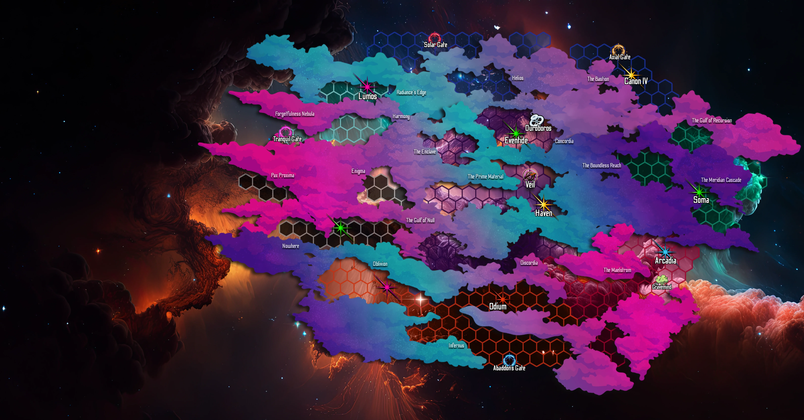

# H.A.W.K Places

The map, its regions and its places.

## The Core Sector — `core-sector`

The neutral hub of the Astral Sea, and for now the only part of it the faction game maps. On the grid it is a broad, ragged mass, wider east to west than north to south: about 21 hexes across and 15 rows deep. The Drift, shown as clouds, covers most of it. Open space, where the hex grid shows through, appears only in scattered clearings.

Beyond its edges is open Astral Sea: dark space, with a huge orange-red nebula along the west and south-west and a red one off the south-east. Four charted gates sit on the rim and lead out to the rim sectors: Solar Gate (north), Axial Gate (north-east), Tranquil Gate (west) and Abaddon's Gate (south).

**Layout** — Each label on the clouds names a region, 19 in all. The clearings fall into seven groups by the colour of their hexes:

- **North rim (dark blue)** — a band of open hexes along the top edge. West to east: Radiance's Edge (just south of Solar Gate), Helios, and The Bastion (by Axial Gate).
- **North-west (teal)** — Forgetfulness Nebula, with Harmony to its east. Tranquil Gate is on the rim at their west end.
- **Centre (purple)** — the hub. Concordia (Eventide and Ouroboros) with The Enclave to its west; south of them The Prime Material (Veil and Haven). Discordia is a separate purple clearing further south.
- **West (black)** — Pax Proxima on the western edge, Enigma between it and the centre, and Nowhere and The Gulf of Null to the south-west.
- **East (green)** — down the eastern side, north to south: The Gulf of Recursion, The Boundless Reach, and The Meridian Cascade.
- **South (red-orange)** — Oblivion in the south-west, then Infernus: the widest open stretch on the map, with Abaddon's Gate on the southern rim.
- **South-east (crimson)** — The Maelstrom.

The grid draws no routes, and Drift surrounds every clearing. Drift currents work as fast links: one lane of current joins two regions. Which regions the lanes join is not yet fixed. The four gates are the only marked ways in or out of the sector, and each is a place on the map. The largest open areas are the north rim band and the red-orange south. The thickest Drift runs as a band across the middle, between the centre and the east, and along the western and south-western edges.

## Radiance's Edge — `radiances-edge`

The Core's brightest stretch, where Solar's light spills through Solar Gate. Radiant Throne patrols and pilgrims are everywhere.

## Lumos — `lumos`

**Region** — `radiances-edge`
**Magic and technology** — High; divine light and Aether-tech
**Population** — Settled

A shrine-port where the Radiant Throne's faithful resupply before Solar Gate. Everyone is very, very welcome.

## Solar Gate — `solar-gate`

**Region** — `radiances-edge`
**Magic and technology** — High; divine
**Population** — Sparse

The gate to Solar, held by the Radiant Throne as its foothold in the Core.

## Helios — `helios`

Open blue space lit by a sun nobody can find. The easiest sailing on the north rim.

## The Bastion — `bastion`

A fortified band around Axial Gate, studded with old Blackwater checkpoints now held by whoever got there first.

## Canon IV — `canon-iv`

**Region** — `bastion`
**Magic and technology** — High
**Population** — Sparse

The fourth of The Bastion's gun platforms. Nobody discusses the other three.

## Axial Gate — `axial-gate`

**Region** — `bastion`
**Magic and technology** — High
**Population** — Sparse

The gate to Axiom, Nyadra'zatha's realm.

## Forgetfulness Nebula — `forgetfulness-nebula`

Drift that dulls memory. Crews come out the far side unsure why they set out. Tranquil Gate sits on its western edge.

## Tranquil Gate — `tranquil-gate`

**Region** — `forgetfulness-nebula`
**Magic and technology** — Moderate
**Population** — Empty

The gate to Tranquility, whose god is unknown. Few go through.

## Harmony — `harmony`

A calm teal clearing, quiet enough that sailors distrust it.

## Concordia — `concordia`

The Core's busiest crossroads, home to Eventide and Ouroboros.

## Eventide — `eventide`

**Region** — `concordia`
**Magic and technology** — High
**Population** — Crowded

The Core's twilight market, neutral ground where every faction trades and nobody admits to it.

## Ouroboros — `ouroboros`

**Region** — `concordia`
**Magic and technology** — High
**Population** — Settled

Ouroboros Station, a ring station that was Blackwater's hub in the Core. What's left of Blackwater still calls it home.

## The Enclave — `enclave`

A small clearing west of Concordia, cut off by thick Drift. Its residents like it that way.

## The Prime Material — `prime-material`

The Core's closest approach to the Material Plane, home to Veil and Haven. The Aether here feels like home.

## Veil — `veil`

**Region** — `prime-material`
**Magic and technology** — Highest
**Population** — Teeming

The City of Gates: interlocking rings, the gateway between the Material Plane and the Astral Sea. Since the Pact broke, the Fey Royals rule it, and the Coven of Morgana runs the city day to day. Seraph Industries keeps its seat here too, with no say in how Veil is run.

## Haven — `haven`

**Region** — `prime-material`
**Magic and technology** — Highest
**Population** — Crowded

The first Material Plane colony in the Astral Sea, founded by O.W.L. and the Coven in 672. Concentric rings around a central spire, floating above an ocean world. Home to the wealthy elite, the workers who serve them, and Undine University.

## Discordia — `discordia`

A broken clearing south of the hub where currents clash. Ships that linger get pulled apart.

## Pax Proxima — `pax-proxima`

A dark, quiet clearing on the western rim, named for a peace treaty nobody remembers signing.

## Enigma — `enigma`

A dark clearing between Pax Proxima and the hub. No two charts of it agree.

## Nowhere — `nowhere`

A dark expanse in the south-west that most charts mark as empty. It isn't.

## Somewhere — `somewhere`

**Region** — `nowhere`
**Magic and technology** — Low
**Population** — Sparse

A smugglers' outpost every chart leaves off. If you're looking for it, you're in the wrong place.

## The Gulf of Null — `gulf-of-null`

Dead space where Aether thins out. Engines falter and casters go quiet.

## The Gulf of Recursion — `gulf-of-recursion`

Currents that loop back on themselves. The fastest way through is to have already been through.

## The Boundless Reach — `boundless-reach`

A wide band of Drift across the east, always longer to cross than it looks.

## The Meridian Cascade — `meridian-cascade`

Green Aether falls through the Drift here in slow torrents: the richest harvest in the Core.

## Soma — `soma`

**Region** — `meridian-cascade`
**Magic and technology** — Low
**Population** — Settled

A refinery Fragment on the Cascade that bottles green Aether into elixirs.

## Oblivion — `oblivion`

A red-lit clearing in the south-west where lost ships end up.

## Lethe — `lethe`

**Region** — `oblivion`
**Magic and technology** — Low
**Population** — Sparse

A field of wrecks drifting in from Oblivion, worked by salvagers who don't ask where things came from.

## Last Light — `last-light`

**Region** — `oblivion`
**Magic and technology** — Moderate
**Population** — Crowded

An anchorage around a white flare that never goes out, and the home port of the Thymian Armada.

## Infernus — `infernus`

The widest open stretch in the Core, hot with infernal light from Abaddon's Gate. The Court of Lies' doorstep.

## Odium — `odium`

**Region** — `infernus`
**Magic and technology** — Moderate; infernal
**Population** — Crowded

A cult Fragment in the Court of Lies' shadow, where grudges are the local currency.

## Abaddon's Gate — `abaddons-gate`

**Region** — `infernus`
**Magic and technology** — High; infernal
**Population** — Sparse

The gate to Abaddon, held by the Court of Lies as its foothold in the Core.

## The Maelstrom — `maelstrom`

A churning crimson storm wrapped around Arcadia.

## Arcadia — `arcadia`

**Region** — `maelstrom`
**Magic and technology** — Low
**Population** — Sparse

An Astral Fragment inside The Maelstrom, settled by O.W.L. as a colony.
