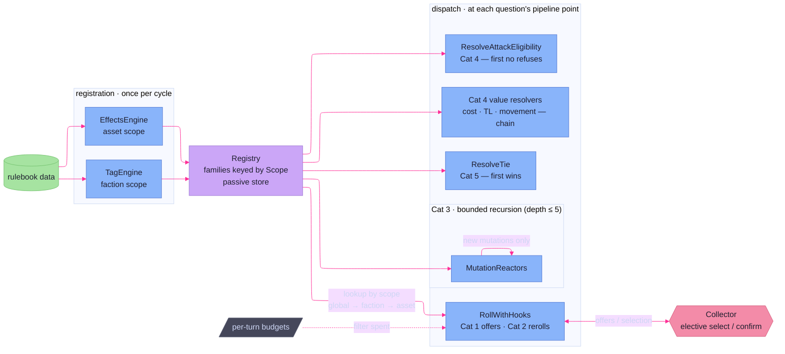

# Hooks

> **Code:** `internal/faction/engine/hooks/`, `internal/faction/engine/hooks/dispatch/`

## Purpose

Hooks are how a faction's tags and an asset's special features bend the rules of
a turn without the core engine knowing they exist. The package defines **five
families of reactive mechanic** — pre-roll dice augmentation, post-roll rerolls,
post-mutation reactions, query-time rule alterations, and tie-breaks — plus a
single `Registry` that binds each registered hook to a **scope** (global, a
faction, or one asset instance). The [tag and effect engines](effect-mutation.md)
*register* hooks from rulebook data at cycle start; the orchestrator and the
sub-engines *dispatch* them at the exact points in the pipeline where each
question gets asked. This page is the home for the hook taxonomy, the scope
lookup, and the dispatch model; the registrar side lives on the
[effect & mutation](effect-mutation.md) page.

## Shape

A hook's life has two halves that never meet directly: **registration** writes
an implementation into the registry under a scope; **dispatch** reads it back out
at a pipeline point and runs it. The registry is the only thing the two halves
share, and it is a passive store — it never calls a hook itself.

### The five categories

`doc.go` is the canonical outline; the categories are numbered for shorthand
(a tag is described as exercising "Cat 1 + Cat 5," etc.):

| # | Interface | Fires | Dispatched from |
|---|-----------|-------|-----------------|
| 1 | `RollModifier`, `RollOfferFilter` | before a roll — offers extra dice; filters may strike offers | `RollWithHooks` (every faction roll) |
| 2 | `RollResultHook` | after a roll — may reroll specific dice | `RollWithHooks` (every faction roll) |
| 3 | `MutationReactor` | after a phase's mutations — may emit more | orchestrator, after movement & action |
| 4 | `RuleModifier` family | at a rule query — alters the answer | the query site (purchase, bookkeeping, movement, attack targeting) |
| 5 | `TieResolver` | at an attack/defense tie | `ResolveTie` (combat) |

Category 4 is not one interface but a **typed family** — `AssetCostModifier`,
`MaintenanceCostModifier`, `WorldTechLevelModifier`, `AttackEligibilityRule`,
`AssetMovementGranter` — each with its own signature
(`ModifyAssetCost(buyer, def, world, query *AssetCostQuery)`,
`MayFight(query AttackEligibilityQuery) bool` and so on). The asset-cost hook
edits a shared `AssetCostQuery` in place of returning an `int`, because the chain
carries more than a number: `Applied` holds the `no_stack` marks, and `Surcharges`
holds the parts of the cost that a purchase discount must not remove, each with
the faction that imposed it (`dispatch.PurchaseCharges` charges each one as its
own `CoinDelta`, caused by that faction). They are split rather than folded into one generic
`Modify(any) any` precisely so the compiler keeps each question's argument and
return types honest; see Key Decisions.

### The registry and scope lookup

`Registry` holds one `map[Scope][]Registered…` per category. A `Scope` is a
comparable struct — a `ScopeKind` (Global / Faction / Asset) plus an optional
faction ID and asset-instance ID — so it works directly as a map key:

```go
type Scope struct {
	Kind            ScopeKind
	FactionID       string
	AssetInstanceID string
}
```

Registration is `registry.Register<Category>(scope, source, hook)`; the `source`
string (e.g. a tag or asset name) is carried only for diagnostics. Lookup is the
mirror — `registry.<Category>For(factionID, assetInstanceID)` — and it returns
matches in a **fixed precedence: global hooks first, then faction-scoped, then
asset-scoped, in registration order within each bucket.** Asset scope is only
consulted when an asset-instance ID is supplied, so a faction-level query never
accidentally drags in per-asset hooks. This ordering is the whole contract a
dispatcher relies on: it can walk the returned slice and trust that broader-scope
hooks act before narrower ones.

Cat 3 is the exception. A reactor answers "what just happened", not a question
asked on behalf of one faction, so its dispatcher needs every bucket, not one
faction's slice. The registry exposes the buckets separately —
`MutationReactorsGlobal()`, `MutationReactorsForFaction(factionID)`,
`MutationReactorsForAsset(factionID, assetInstanceID)` — and the dispatcher
composes them.

Cat 1 and Cat 2 are also exposed per bucket (`RollModifiersAt(scope)`,
`RollOfferFiltersAt(scope)`, `RollResultHooksAt(scope)`), and have no `…For` lookup, because the roll
dispatcher builds its own scope list.

Three Cat 4 families also expose one asset's bucket alone —
`AssetCostModifiersForAsset`, `WorldTechLevelModifiersForAsset` and
`AttackEligibilityRulesForAsset`. A resolver that walks several assets uses them,
so it asks the global and faction buckets once and not once per asset. They also
let a resolver ask a rival's asset without that rival's faction hooks: Local
Investments on the purchase world, or the target of an attack.

### Registration in, dispatch out

The registry is cleared (`Registry.Reset`) and populated once, at the start of
each cycle, by the two
registrars on the [effect & mutation](effect-mutation.md) page: `TagEngine`
registers faction-scoped hooks from the tags a faction holds, `EffectsEngine`
registers asset-scoped hooks from each asset's `S`-flag features. Nothing else
writes to the registry, and neither registrar ever dispatches.

Dispatch is the opposite of centralized. There is no single "run all hooks"
call; instead each category is consulted **at the pipeline point where its
question is genuinely being asked**, by the `dispatch` sub-package:

- **`RollWithHooks`** wraps every faction roll: attack and defense, the Expand
  Influence test, rival rolls and free attack, and the ability contest
  ([actions](actions.md)). S-side contests (`effects/contest.go`) roll directly,
  because a reactor has no collector. It consults global, the roller's faction, and the asset buckets of the
  roller's and the opponent's assets on the roll's world (plus the rolling and
  opposing assets when off-world), in asset-ID order. Never the opponent's
  faction bucket: tag hooks assume the roll is their own. It gathers Cat 1 offers, runs Cat 1 offer filters over them (Blackmail strips tag dice —
  `ModifierOffer.FromTag`), hands them to the [collector](#the-collector-seam) for
  selection, expands and rolls the dice pool, applies keep-highest, then runs Cat
  2 reroll directives — so one call covers both roll-time families.
- **`MutationReactors`** runs after the orchestrator applies a phase's mutations
  (movement and action phases), letting Cat 3 reactors respond to what just
  happened. It runs **every** registered reactor, not only the acting
  faction's: global, then each faction's, then each of that faction's assets,
  sorted by faction ID and then asset ID so the emitted mutations are
  deterministic. A defender's reactor hears what was done to it; each reactor
  filters the batch for the events it cares about.
- **`ResolveAssetCost` / `ResolveMaintenanceCost` / `ResolveWorldTechLevel` /
  `GrantedMovementAbilities`** are the Cat 4 value resolvers, called from
  [`buy_asset`](actions.md) and `purchase_enabler`, [`bookkeeping`](turn-pipeline.md),
  the TL-gate on purchase, and the movement phase respectively. The three number
  resolvers **chain** their modifiers — every modifier sees the previous one's
  output — so two effects on the same number compose instead of clobbering;
  `GrantedMovementAbilities` collects every granter's list. `ResolveAssetCost`
  asks the buyer's own hooks, then each rival asset on the purchase world in
  asset-ID order. `ResolveWorldTechLevel` and `GrantedMovementAbilities` ask the
  faction's hooks, then each of its own assets in asset-ID order, since a
  tech-level floor or a movement grant serves only its owner. A grant is a
  `MovementAbility` — the granting asset (`Source`, the range origin) and its
  `RelocateParams`. The movement phase runs each grant once, through the shared
  `engine/relocate` package, after the drift decisions apply (see
  [world & movement](world-movement.md)).
- **`ResolveAttackEligibility`** is the fourth Cat 4 resolver, and it answers yes
  or no. It is asked once per defender when the attack target list is built
  (`eligibleDefendersAtHex`, behind `Validate`, `Inputs` and `Resolve`), and once
  before a counterattack deals damage. `Attacker` is always the striker, so on a
  counter the original defender is `Attacker`. The striker's global, faction and
  asset hooks answer as the query's side. On an attack, the target's asset hooks
  then answer as `defense`; a counter is not a defense, so the target is not
  asked. It **refuses on the first no and does not chain**: there is no value to
  pass along.
- **`ResolveTie`** is consulted at a combat tie, asking the attacker's resolvers
  first and the defender's only if the attacker has none; **first registration
  wins** (ties are a binary outcome, so there is nothing to chain).

Every resolver treats a `nil` registry and an empty match list as "no
modification" — pass the base value straight through — so a campaign with no
hooks behaves exactly like one whose hooks all decline.

### The collector seam

Roll-time hooks are the one family that needs a human (or planner) in the loop,
because some modifiers and rerolls are *elective*. The dispatcher reaches the
driver through a narrow `Collector`:

```go
type Collector interface {
	SelectModifiers(offers []ModifierOffer) []ModifierOffer
	ConfirmReroll(directive RerollDirective) bool
}
```

This is the hook-level slice of the engine's [collectors-in seam](orchestrator.md):
the dispatcher offers the Cat 1 modifiers that survive the offer filters and budgets, and the collector returns the
subset to apply; for each *elective* Cat 2 directive the collector confirms or
declines. Non-elective directives apply automatically. `SelectModifiers` is not
called when no offer survives the budget filter.

### Per-turn budgets

A modifier or reroll may carry a `BudgetKey` (namespaced, e.g. `"tag:Warlike"`).
The dispatcher stamps each offer and directive with the faction that registered
it (`FactionID`), and reads and spends the budget on that faction's
`HookBudgets`. An opponent's effect spends its owner's budget. The dispatcher
filters out any offer or directive whose budget is already non-zero this turn — the
mechanism behind "once per turn" effects like Warlike's bonus attack die. An
empty `BudgetKey` means unlimited. The budget map is reset each turn by
[bookkeeping](turn-pipeline.md), so the gating is per-faction-turn, not
per-cycle.

### Bounded recursion

Only **Cat 3 reactors recurse**: a reactor's emitted mutations can themselves
trigger reactors. `reactDispatch` bounds this at **depth 5** and trips an error
on overflow rather than looping forever. Critically, each level recurses on
**only the newly emitted mutations**, not the accumulated set — so a reactor
never re-fires on the mutations that triggered it, and the accumulated result is
built back up on the way out of the recursion. The other four families are
single-shot by construction.



## Key Decisions

- **Category 4 is a typed family, not a generic interface.** Each rule query
  (asset cost, maintenance, world TL, attack eligibility, movement grants) has
  different argument and return types, so a single `Modify(any) any` would throw
  away compile-time safety. Five small interfaces keep every call site honest.
  (`doc.go`; frozen log 158–188.)
- **The registry is cleared in place at the start of every cycle.** The TUI runs
  every cycle on one engine, so registering again without a reset adds another
  copy of every hook each cycle. The maps are cleared in place, not replaced,
  because the actions hold the registry pointer from engine construction.
  (s-flag-effect-registry plan, Decision Record 24.)
- **Scope is a comparable struct used directly as a map key.** Global / faction /
  asset identity collapses into one value type, so the registry is just maps and
  lookup is a fixed global→faction→asset walk — no per-category routing logic.
- **Dispatch is distributed, not centralized.** There is no "run all hooks" beat.
  Each category is consulted at the pipeline point where its question is asked
  (rolls in combat, reactors after a phase, cost modifiers at purchase and
  bookkeeping). A hook only runs where it is meaningful, and adding a dispatch
  site is a local change.
- **Only Cat 3 recurses, bounded at depth 5, on new mutations only.** Reactions
  can cascade, so they need a depth bound; recursing on just the newly emitted
  mutations stops a reactor re-firing on its own trigger, and the cap trips an
  error instead of hanging the turn. The other families cannot recurse.
- **Cat 4 modifiers chain; Cat 5 resolvers do not.** Cost-style answers compose
  (each modifier sees the prior result), so several effects stack. A tie is a
  single binary outcome, so the first registered resolver wins and the rest are
  ignored. Attack eligibility is also yes or no, so it does not chain either: the
  first hook that refuses ends the fight.
- **The eligibility query names the striker, and a counter asks only the
  striker.** `Attacker` is the asset that deals the damage, so on a counterattack
  the original defender is `Attacker`, and a rule such as Lawyers always finds its
  opponent in `Defender`. On an attack the target's asset hooks also answer, as
  `defense`. On a counter the target is not asked: a counter is not a defense,
  and asking it would let Integral Protocols block counter damage to itself. The
  striker is asked through `AttackEligibilityRulesFor` and the target through
  `AttackEligibilityRulesForAsset`, so a global rule is asked once. The query
  carries both definitions, because a Cat 4 hook has no rulebook. Rejected: fixed
  roles, where each hook must find "the other asset" from its own ID.
  (s-flag-effect-registry plan, Decision Record 21.)
- **The collector seam keeps elective hooks out of the engine's hands.** Roll
  modifiers and elective rerolls are offered to the driver; the engine never
  decides them itself. This is the same source-agnostic collector contract the
  rest of the engine uses, narrowed to two methods.
- **Elective rerolls keep per-roll timing.** Cat 2 runs right after each roll, so
  an attacker decides on a reroll before the defense is rolled. Deciding after
  both rolls would split `RollWithHooks` into roll and post-roll calls at every
  call site, and Expand Influence compares one roll against N. A fence-sign at
  the dispatcher marks it. (s-flag Effort 3 plan, Decision 15.)
- **Every S effect registers at asset scope, and checks that its asset is active
  when it fires.** One scope rule means one lookup shape for every effect, and an
  effect always knows the asset that declared it. The check runs at fire time,
  not at registration, because `ApplyAll` runs at cycle start while `Ready` flips
  at the owner's turn start and `Maintained` in each bookkeeping. The rule is
  `domain.Asset.Active()` (`Ready && Maintained && CurrentHP > 0`, the same test
  as attack eligibility). A Cat 4 hook gets no `FactionState`, so it keeps its
  owner from registration and reads `owner.Assets[assetID]` at query time; a
  removed asset reads as nil and fails `effects.active()`. Rejected: holding the
  asset pointer, which keeps a removed asset in effect until the next cycle.
  (s-flag-effect-registry plan, Decision Records 11, 14, 19 and 22.)
- **A rule query that serves its owner walks the owner's own asset buckets.**
  `ResolveWorldTechLevel` and `dispatch.GrantedMovementAbilities` walk global, then the
  faction, then each of the faction's own assets in ID order. This keeps the
  asset-scope rule above without an index, and a grant never leaks to another
  faction. The movement query is per faction (`GrantMovementAbilities(faction)`),
  and each `MovementAbility` names its `Source` asset, because one Transit Web
  moves many *other* assets. Asset cost differs on purpose: it also walks rival
  assets on the purchase world, because a surcharge is a rival's effect.
  Rejected: registration at faction scope. (s-flag-effect-registry plan,
  Decision Record 14; Effort 5 plan, Decision 1.)
- **A budget lives on its owner's `HookBudgets`, keyed by effect, trigger,
  definition and (when `once_per` asks) target or asset.** `HookBudgets` is
  cleared in each faction's own bookkeeping, so a budget written to another
  faction's map would reset at an unpredictable point in the cycle. On the roll
  path the dispatcher stamps the owning faction (`FactionID`) on every offer and
  directive, never the hook, so a forced reroll spends the effect owner's budget,
  not the roller's. The trigger is in the key so two entries of one definition
  (Book of Secrets) do not share a budget. (s-flag-effect-registry plan, Planning
  Decision 3; Effort 3 plan, Decisions 8 and 16.)
- **The roll dispatcher reads asset buckets on the roll's world from both sides,
  but never the opponent's faction bucket.** An S effect such as Book of Secrets
  or Panopticon Matrix acts on a roll made by or against its owner on its world,
  so the dispatcher gathers both sides' asset buckets there, plus the rolling and
  opposing assets when they stand elsewhere. Tag hooks register at faction scope
  and assume the roll is their own faction's (Fanatical rerolls every 1 without
  checking the actor), so the opponent's faction bucket stays out. Each S roll
  hook checks its owner relation against `ctx.Actor` / `ctx.Opponent` itself.
  (s-flag Effort 3 plan, Decision 7.)
- **Reactors in one dispatch round cannot see each other's output, so a shared
  limit needs a lead.** Every reactor in a round reads the same input batch and
  the state from before it. When several reactors draw on one limit — Banks on the
  owner's budgets, thieves on the target's Coin — each would decide alone and
  together overrun it. So only the owner's lowest-ID active asset with the effect
  reacts, for all of them: it walks the batch in order and tracks what is left.
  Bank leads per definition; `coin_steal` leads across definitions, reading
  each thief's entries from the rulebook. Rejected: letting each reactor see
  its earlier siblings' output, which changes the input of every reactor.
  (s-flag-effect-registry plan, Decision Records 9 and 26.)
- **A Cat 3 reactor gets its roller at registration.** `OnMutations` takes no
  `Roller`, but some reactors roll dice (`coin_steal`, `self_damage`, the contest
  gate). `RegisterContext` carries the engine roller, and `ApplyAll` runs at the
  start of each cycle, so a test that swaps `Engine.Rand` before the run still
  controls the dice. Rejected: a `Roller` parameter on `OnMutations`, which
  changes every reactor for three effects. (s-flag-effect-registry plan, Decision
  Record 3.)

## Dependencies

**Depends on** [`domain`](effect-mutation.md) (mutations, `Faction`, `Asset`,
roll types), [persistence & static data](persistence.md) (`FactionState` and the
`Rulebook` that hooks read at dispatch), and a `Collector` supplied by the
driver. The package defines the contracts; it owns no game data of its own.

**Registered by** the tag and effect engines on the
[effect & mutation](effect-mutation.md) page — the only writers to the registry.
**Dispatched by** the [orchestrator](orchestrator.md) (Cat 3 reactors after
movement and action), the [actions](actions.md) engine (Cat 1/2 on every faction roll, Cat 5 in combat, Cat
4 asset-cost and tech level at purchase, Cat 4 attack eligibility in combat), and the [turn pipeline](turn-pipeline.md) (Cat 4
maintenance-cost at bookkeeping). Emitted reactions flow back through the same
[mutation apply layer](effect-mutation.md) as every other state change.
