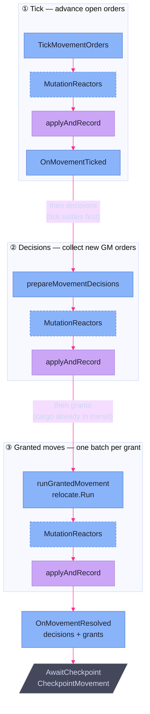

# World & Movement

> **Code:** `internal/faction/engine/world/`; movement-phase consumers in `internal/faction/engine/orchestrator.go`

## Purpose

The world engine answers two questions a faction turn needs: *where is
everything right now*, and *what is in transit between worlds*. It holds a
per-turn **spatial index** — a snapshot of every asset and base keyed by world
and by hex, rebuilt at the start of each faction's turn — and it owns
**movement orders**, the multi-turn transit records that tick a slow asset
across the map one speed-step at a time. It does the bookkeeping of *who moves
where*; it delegates the geometry of *how far* and *by what path* to the
[spatial](spatial.md) map through a single seam. Like every engine subsystem it
never writes state — it emits [mutations](effect-mutation.md).

## Shape

`engine/world/` is one package telling one story across two files: `world.go`
(the index and the spatial seam) and `movement.go` (orders). The orchestrator's
movement *phase* — the sequencing, hook dispatch, and GM prompts — lives beside
them in `orchestrator.go`, because it is pipeline orchestration, not world logic.

### The per-turn index

`RebuildIndex` walks the whole faction state once and produces an `Index`:

```go
type Index struct {
	AssetsByLocation map[string][]*domain.Asset   // settled assets, by world ID
	BasesByLocation  map[string][]*domain.Base     // bases, by world ID
	AssetsByHex      map[spatial.RegionHex][]*domain.Asset // every asset, by hex
}
```

The orchestrator rebuilds it at **setup, once per faction turn**, so every
later phase reads a current snapshot without re-scanning. The split between the
two asset maps is deliberate: an **in-flight** asset (one whose `Location` has an
empty `WorldID` — it is mid-drift between worlds) has no settled world, so it
appears in `AssetsByHex` but *not* in `AssetsByLocation`. Hex is the only
coordinate that is always meaningful; world membership is the thing that lapses
during transit.

A `Location` referencing a world the [spatial](spatial.md) map doesn't know is
**skipped, not fatal**: `RebuildIndex` collects the unknown world IDs and returns
them, and the orchestrator forwards them to `observer.OnIndexSkipped` so the
driver can surface "this asset is somewhere the map can't place." A typo in
campaign data degrades one entity, it doesn't abort the turn.

### The spatial seam

The world engine never imports the map's internals. It depends on a narrow
`HexRouter` interface — the read-only [`SpatialMap`](spatial.md) plus `Distance`,
`DistancesFrom`, `Path`, and `AllWorlds` over `RegionHex` — and `spatial.RegionMap`
is asserted to satisfy it (`var _ HexRouter = (*spatial.RegionMap)(nil)`). This is
the seam named in the [engine overview](overview.md): movement asks the map for a
route and a cost and stays ignorant of how regions, warps, and crossing costs
produce them. `DistancesFrom` (one Dijkstra pass to every reachable hex) and
`AllWorlds` (the full world list) are what the instant-relocation enumerators
below ask of the map.

### Movement orders

A `domain.MovementOrder` is the durable transit record carried on the asset
(`asset.CurrentOrder`): its `Origin`, `Destination`, the full `Path` of hexes,
the current `StepIdx`, the `DriftRating` that priced the route, and the
`CargoAssetIDs` riding along. Orders move through two engine entry points:

- **`TickMovementOrders`** advances each asset with an open order by its
  `def.Speed` hexes. If the new step index reaches the end of the path it emits a
  `MovementOrderCompleted` (settling the asset at its destination); otherwise a
  `MovementOrderProgressed` carrying the new hex and step. Speed is hexes-per-
  turn, so a fast asset eats more of its path each tick.
- **`BuildMovementMutations`** turns GM **decisions** into order mutations. There
  are three kinds: **Issue** paths from the asset's current hex to a destination
  (pricing the route with `rulebook.DriftCost(def.DriftRating)` as the per-
  crossing cost) and emits `MovementOrderIssued`; **Revise** re-paths a live
  order from the asset's *current* hex, costs **1 Coin** (a paired `CoinDelta`),
  and carries the old order's cargo forward via `MovementOrderRevised`; **Cancel**
  emits `MovementOrderCancelled`, stranding the asset at its current `Location`.

### The movement phase

`runMovementPhase` runs its steps in a fixed order and dispatches reactor
[hooks](hooks.md) after *each* mutation batch:

1. **Tick first.** `TickMovementOrders` advances open orders, in asset ID order.
   `checkArrivals` (`engine/arrival.go`) then reads each `MovementOrderCompleted`.
   A Transport Lockdown on the destination comes first: the order pays 1d4 Coin and
   holds a turn (`MovementOrderHeld`, `lockdown_paid`, which sets the order's
   `LockdownPaid`), or holds unpaid until it can pay. Otherwise it asks the
   destination's government for every `P` asset aboard (the carrier, then its
   cargo), and the first refusal replaces the completion with a `PermissionRefused`
   and a `MovementOrderHeld` one hex short of the world. The
   tick's mutations then go through `MutationReactors` (so held cargo stays with its
   carrier) and `applyAndRecord`, and the driver is notified via `OnMovementTicked`.
2. **Then decisions.** `prepareMovementDecisions` collects new GM orders;
   *their* mutations go through their own `MutationReactors` pass, then
   `applyAndRecord`.
3. **Then granted moves.** `runGrantedMovement` asks
   `GrantedMovementAbilities` for the faction's free movement grants (Cat 4
   `AssetMovementGranter`) and offers each grant once through
   `relocate.Run`. Each grant is its own batch — `MutationReactors`, then
   `applyAndRecord` — so the next grant sees the Coin and locations the last
   one changed. A grant with nothing in range, one the faction cannot pay for, or
   one the GM declines (no orders, or Esc) is skipped; an unaffordable grant is
   also reported through `OnError`. The driver then gets one
   `OnMovementResolved` carrying the decision mutations and every grant's.
4. **Checkpoint.** The phase ends at `AwaitCheckpoint(CheckpointMovement)`, a
   pause point for the driver.

Tick-before-decisions is load-bearing: an asset that *completes* its transit
this tick is settled before the GM is asked what to do with it, so the decision
menu reflects the post-tick world. Dispatching reactors per batch is what lets a
transport's cargo-follow reaction fire on the tick's progress mutations *and* on
a freshly issued order. Grants-after-decisions is load-bearing too: a transport
order puts its cargo in transit (no `WorldID`) only when its batch applies, so by
the time a grant runs, cargo loaded this phase is out of range and cannot be moved
twice.

### Eligibility and cargo

Two orchestrator helpers gate what the GM may move:

- **Movable assets** are those whose definition has `Speed > 0`
  (`eligibleMovableAssets`). A stationary asset is never offered a move of its
  own.
- **Cargo** is the inverse. `eligibleCargoForTransport` accepts an asset only if
  it is *immobile* (`Speed == 0`), has no order of its own, sits in the
  transport's hex, and matches the transport profile's `CargoTypes` while dodging
  its `ExcludeCategories` — capped at `MaxCargo`. So a transport ferries the
  things that cannot move themselves; self-propelled assets travel under their
  own orders.

The manifest stops here. `BuildMovementMutations` records *which* assets are
cargo on the order, but the act of **dragging cargo to the transport's new hex
is a [`TransportReactor`](effect-mutation.md)**, not world-engine code — a
deliberate split that keeps cargo location recoverable if the transport dies
mid-flight.



### Instant relocation

Abilities need a *different* move: not a multi-turn drift order but an immediate
jump. `BuildRelocateMutations` is the world engine's second entry point — distinct
from the drift-order `TickMovementOrders`/`BuildMovementMutations` above. It
validates a destination against a caller-supplied `legalWorlds` list and emits an
`AssetMoved` for the moved asset (plus a `CoinDelta` when the move costs Coin),
settling it **this turn** with no order, no path, and no tick. The mutation's
`Cause` is `"ability"`, distinguishing a relocate from a drift-phase move.

The range geometry lives in two enumerators beside it: `WorldsWithin` returns
every world within *N* raw hexes of an origin (one `DistancesFrom` pass at crossing
cost 0 — raw hex distance, *not* the drift-priced journey ChangeHomeworld uses),
and `WorldsInRegion` returns every world sharing the origin's region (a pure
`RegionID` equality check, no distance math). Both route through a shared
`worldsMatching` predicate helper. `BuildRelocateMutations` stays
range-mode-agnostic — the enumerator picks the legal set, the primitive only
validates membership and emits.

The orchestration around these lives in one shared package, `engine/relocate`.
`relocate.Run` picks the enumerator by range mode, gathers the movable candidates
(the acting asset for self-scope; for other-scope, the faction's in-range assets
that pass the type, category and excluded-type filters and have no movement order),
prompts through `relocate.Collector`, checks Coin, asks the destination's
government for each `P` asset it moves (`dispatch.RequestArrivalPermission`, cause
`relocate`), and calls `BuildRelocateMutations` for each order that may land. A
refused order stays where it is and leaves a `PermissionRefused`; the others move.
Under the `flat` cost mode only the first order that moves carries the cost. Two harnesses call it: a spent `relocate` ability in the action
phase (the action collector prompts), and a free movement grant in the movement
phase (the phase collector prompts). `Run` reports "nothing to do" as sentinels —
`ErrNoCandidates`, `ErrInsufficientCoin`, `action.ErrNoSelection` — and each
harness decides what they mean: the ability surfaces them as errors, the grant
runner skips the grant.

## Key Decisions

- **The index is rebuilt fresh each faction turn, not mutated incrementally.** A
  full re-scan at setup is cheap at campaign scale and removes a whole class of
  staleness bugs: every phase reads a snapshot that was correct as of this turn's
  start, and mutations applied during the turn never have to be mirrored into the
  index.
- **In-flight assets are indexed by hex only.** An asset between worlds has no
  settled `WorldID`, so it is deliberately absent from `AssetsByLocation` and
  present only in `AssetsByHex`. Hex is the one coordinate that survives transit.
- **Unknown worlds are skipped and surfaced, never fatal.** A `Location` the map
  can't resolve is collected and reported through `OnIndexSkipped`; bad campaign
  data degrades one entity rather than aborting the turn.
- **Geometry lives behind the `HexRouter` seam.** The world engine asks the
  [spatial](spatial.md) map for distance and path and nothing more, so movement
  logic is independent of how the map computes routes, warps, and crossing costs.
- **Tick before decisions.** Open orders advance before the GM is prompted, so
  completed transits are already settled when the decision menu is built. (Own
  completed doc: `asset-movement-redesign-tick-decision-ordering`.)
- **An arrival asks at the tick that would complete it, and a refusal holds at the
  edge.** The government asked is the one ruling when the order arrives, not when it
  was issued, and a held order asks again at its next tick (D-24, D-27). One refusal
  holds the whole order with its cargo, so an immobile rider is never left in space
  (D-28). The hold is its own record, `MovementOrderHeld`, so history never shows a
  move that did not happen. (A.001.6 overview Decisions 16 and 22; Effort 5 Decision 1.)
- **The movement phase dispatches reactors per batch.** Tick mutations and decision
  mutations each get their own `MutationReactors` pass, so reactive effects fire
  on both transit progress and newly issued orders. (Frozen log 227–235.) Each
  granted move is a further batch with its own pass (S-flag Effort 5 Plan,
  Decision 6).
- **Revision costs 1 Coin and re-paths from the current hex.** Changing a live
  order is a real in-game action with a price, and it re-routes from where the
  asset actually is, not its original origin.
- **Only immobile assets can be cargo; cargo-follow is a reactor.** The world
  engine records the manifest but does not move the cargo — a
  [`TransportReactor`](effect-mutation.md) emits the cargo `AssetMoved`s — so the
  manifest and the movement stay decoupled and cargo location is recoverable.
- **Instant relocation is a distinct entry point from drift orders.**
  `BuildRelocateMutations` settles an asset at its destination the same turn — no
  order, path, or tick — so an ability's move is immediate where a drift order is
  multi-turn. The two share the world engine but not a step: a free movement grant
  runs in the movement phase, but as an instant relocate after the drift decisions,
  never as an order. (Effort 3 Plan, Decisions 3 & 5; S-flag Effort 5 Plan,
  Decision 6.)
- **Relocate reuses `AssetMoved`; it adds no new mutation.** An instant move is the
  same state change as a cargo follow — an asset's `Location` changes — so it emits
  the existing `AssetMoved` (with `Cause: "ability"`) rather than a parallel
  relocate mutation, and the apply layer needs no new arm. (Effort 3 Plan,
  Decision 4.)
- **One relocate orchestration serves both harnesses, behind one collector.**
  `engine/relocate` holds the single copy of enumerate → filter → prompt → ask →
  build. The action-spent harness (`ability`) and the free harness (the movement
  phase) both call `relocate.Run`, and both of their collectors satisfy
  `relocate.Collector` (the orders and the permission request), so the prompts are
  shared too, not just the pure parts.
  `relocate` imports `action` (for `RelocateOrder`); `world` does not, so there is
  no cycle. `Run` reports "nothing to do" with sentinels (`ErrNoCandidates`,
  `ErrInsufficientCoin`, `action.ErrNoSelection`), and each harness decides what
  they mean: the action-spent harness surfaces them as errors, and the free
  harness skips the grant. Esc (`ErrTurnCanceled`) also declines only that
  grant, because the decision batch has already applied and the phase must still
  resolve. Rejected: exporting the code from `ability` and importing it in the
  orchestrator, which makes the engine depend on an action sub-package.
  (s-flag-effect-registry plan, Planning Decision 2; Effort 5 plan, Decisions 2
  and 3, Decision Record 2.)
- **A relocate asks for each order after the pick, and a refusal drops that order
  only.** The prompt offers one world list for every candidate, so a per-asset
  permission cannot filter it; asking after the pick keeps the collector unchanged.
  The other orders still move, and a refused order charges nothing. (A.001.6
  Effort 5 Decision 8.)
- **Relocate skips an asset that has a `CurrentOrder`.** An asset that leaves on
  a drift order keeps its origin `WorldID` until the next tick. A relocate would
  move it while its order keeps running from the old path. The guard matches
  `eligibleCargoForTransport` and covers both harnesses, so it also closes the
  gap on the A side. (s-flag Effort 5 plan, Decision 4.)

## Dependencies

**Depends on** [spatial](spatial.md) (through the `HexRouter` seam — distance and
pathing), [`domain`](effect-mutation.md) (`Asset`, `Location`, `MovementOrder`,
the movement mutations), and [persistence & static data](persistence.md) (the
`Rulebook` for asset `Speed`, `DriftRating`, transport profiles, and drift
costs).

**Depended on by** the [orchestrator](orchestrator.md), which rebuilds the index
at setup and runs the movement phase, and the [effect & mutation](effect-mutation.md)
transport reactor, which reads the cargo manifest these orders carry. The index
is also read by [goals](goals.md) for location-aware progress checks. Every order
change is a [mutation](effect-mutation.md), applied through the same gate as all
other state changes.
