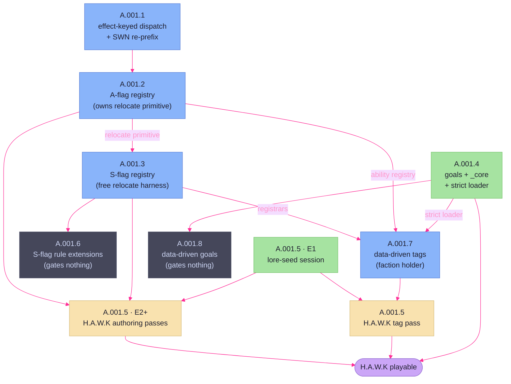

# Data-Driven Rulebook — Arc Plan

> **What this doc is.** The slicing of the `data-driven-rulebook` arc (A.001) into
> ordered initiatives — the DAG, each initiative's boundary, where every arc-discovery
> open question and reconciliation item lands, what gates what, and what the arc does
> not touch. It does **not** re-open the cross-cutting decisions; those are settled in
> the [arc-discovery](A.001-data-driven-rulebook-arc-discovery.md) (ACD-1…ACD-9) and bind
> every initiative below.
>
> **Inputs:** the [arc-discovery](A.001-data-driven-rulebook-arc-discovery.md) (binding —
> its Per-initiative seed, Open Questions, and Reconciliation items are the raw
> material here), the [arc-concept](A.001-data-driven-rulebook-arc-concept.md) (non-binding
> candidate list), and the [ability & effect catalog](../../../architecture/engine/ability-catalog.md)
> (binding mechanical decomposition, ACD-8).
>
> **Status:** signed off, and **amended three times since**. The A.001.3 Discovery split the
> S side into two initiatives and reset A.001.3's boundary (AP-7). The A.001.4
> Discovery narrowed `_core` to goals, kept tags per rulebook, and added A.001.7 and
> A.001.8 from the `E.002` exploration (AP-8). The A.001.7 Discovery widened A.001.7
> to all 20 SWN tags, including tags that grant actions or assets, and added a
> dependency on A.001.2 (AP-9). Amendments are
> recorded in the Decision Record and folded into the body, so this doc stays the
> current arc shape rather than a snapshot of sign-off. Each initiative is registered in
> `planned-work.md` and runs its own lifecycle (session-modes section 9).

## The arc in eight initiatives

| ID | Initiative | Type | Depends on |
|---|---|---|---|
| **A.001.1** | Effect-keyed A-dispatch + SWN re-prefix | refactor | — (arc entry) |
| **A.001.2** | A-flag ability registry | feature | A.001.1 |
| **A.001.3** | S-flag effect registry | feature | A.001.2 *(relocate primitive only)* |
| **A.001.4** | Goals/tags neutralization + `_core` home | feature | — |
| **A.001.5** | H.A.W.K asset authoring | feature | A.001.2, A.001.3, its own lore-seed effort; A.001.7 *(tag pass only)* |
| **A.001.6** | S-flag rule extensions | feature | A.001.3 |
| **A.001.7** | Data-driven tags | feature | A.001.2 *(ability registry, Effort 4 only)*, A.001.3, A.001.4 |
| **A.001.8** | Data-driven goals | feature | A.001.4 |

> **A.001.6 was added after sign-off,** by the A.001.3 Discovery session (AP-7). The
> plan first treated the whole S side as one initiative. The asset inventory split it
> in two.
>
> **A.001.7 and A.001.8 were added after sign-off,** by the A.001.4 Discovery session
> (AP-8), from the `E.002` exploration. A.001.4 keeps its name, but its scope is now
> goals only: tags stay in each rulebook.
>
> **A.001.7 was widened after promotion,** by the A.001.7 Discovery session (AP-9). It
> covers every SWN tag, so a tag that grants an action reaches A.001.2's ability
> registry.

The arc is a DAG, not a line: A.001.4 and A.001.5's lore-seed effort carry no
dependency on the registries and can run from the start; the registries themselves are
the only strictly-serial spine (A.001.1 → A.001.2 → A.001.3's relocate slice).
A.001.6 hangs off A.001.3 and gates nothing — it completes the SWN S-side rather than
unlocking anything downstream. A.001.7 and A.001.8 hang off A.001.4's strict loader.
A.001.7 also reuses A.001.3's registrars and A.001.2's ability registry (AP-9), and
gates A.001.5's tag pass. A.001.8 gates
nothing.

## Per-initiative boundaries

### A.001.1 — Effect-keyed A-dispatch + SWN re-prefix (refactor)

The ID/dispatch-layer refactor that unblocks the A-registry and hardens the SWN data
against ID changes. Two efforts, ordered:

- **Effort 1 — R.018, effect-keyed dispatch.** Replace `dispatch.go`'s
  `map[def.ID]AbilityHandler` with dispatch keyed on the ability's effect/primitive.
  Re-key the one real handler (`informers` → a `reveal_stealth` handler); the nine
  `confirmApplied` stubs collapse into the unknown-effect fallthrough. No new behavior —
  this re-keys, it does not author the registry.
- **Effort 2 — SWN re-prefix.** Rename SWN asset IDs (`C1-001` → `SWN-C1-001`) across
  `rulebooks/swn/assets/`; chase the hardcoded references (`B.001`'s
  `stealth_applicator`, the `G.012` goal ref); fix the test fixtures that pin old IDs.
  **Sequenced after Effort 1** so that, with dispatch already effect-keyed, the rename
  no longer touches dispatch code (arc-discovery seed).

**Covers:** making A-dispatch mechanic-keyed; the dataset-wide SWN ID rename.
**Punts:** the A-side composition pipeline and primitives (A.001.2); any contest/roll
extraction beyond what re-keying strictly needs.

### A.001.2 — A-flag ability registry (feature) — depends A.001.1

The composition pipeline, data-driven and effect-keyed: *target-selection →
(stat-contest | die-roll + outcome-table) → effect → mutations* (ACD-3). Extract the
stat-contest currently wired inside `informers`; fill or remove the dead
`Die`/`Outcomes` fields and resolve the dropped `[[ability.steps]]` (ACD-5); add the
A-side `coin_steal`/`coin_drain` handlers where the effect is action-spent. Grow the
flat `abilityRecord` to carry the structured `[ability]` block.

**Owns the shared `relocate-other` primitive (ACD-4):** builds the world-engine
relocate move (distinct from the drift-order path) **and** its action-spent harness
(Covert Shipping `C3-003`, Covert Transit Net `C6-002`). A.001.3 reaches the same
primitive through a free harness.

**Covers:** the A-side spine and its effects (catalog A-flag table); the relocate
primitive + action-spent harness; A-side latent-vocab repair.
**Punts:** all S-side hook/profile work and the free relocate harness (A.001.3); the two
A-flag *restriction* abilities — Marketers `coin_or_disable` and Seditionists
`attach`/restrict-action — whose effect is a persistent restriction enforced at a future
attack (S-side), rerouted to A.001.3 (AP-6).

### A.001.3 — S-flag effect registry (feature) — depends A.001.2 (relocate primitive only)

> Boundary reset by the A.001.3 Discovery (AP-7). The text below replaces the
> sign-off version, which assumed the whole S side was one initiative. Full detail in
> the [discovery doc](../../_completed/_archive/discovery/s-flag-effect-registry-discovery.md).

Build the data-driven S-side model and ship every effect that is a **hook or a rule
query**. An S-flag ability is declared as *trigger → filters → gates → effect*; the
engine keys its registry on the effect name, mirroring the A-side, and each registrar
decides which hooks its effect needs. The hook category is never named in the data.

**Extend the dispatch (eight items).** The hook framework is complete in its categories
and incomplete in its reach, because transport — the one built S mechanic — is an
attacker-side, own-turn effect that exercises none of it. Cat 3 reactors reach only the
acting faction and never asset scope; roll hooks see only the roller's own hooks and
fire in the Attack action alone; the Cat 4 asset-cost lookup is buyer-scoped;
`GrantedMovementAbilities` has no caller; no hook is consulted on who may fight whom;
and `on_purchase` needs a second dispatch route, because `ApplyAll` runs at cycle start.

**Free relocate harness (ACD-4):** register an `AssetMovementGranter` from the asset's
profile, **wire `GrantedMovementAbilities` into the movement phase** (the seam exists
half-built and unconsumed today), and grow `MovementAbility` from its `{Name,
Description}` placeholder to carry the relocate parameters (Transit Web `SWN-W7-003`).
Invokes A.001.2's primitive without spending the action, from one shared copy.

**Covers:** the trigger/filter/gate/effect model and its loud-failure loader rules; the
eight dispatch extensions; **19 assets** — every S-flag effect that registers a hook or
answers a rule query, including the free relocate harness.
**Punts:** the A-side (A.001.2); the relocate primitive itself (consumes A.001.2's);
migrating `[transport]` onto the new model (deferred while it works — backlog refactor);
the 14 assets that need new state, a new prompt, or a new subsystem (A.001.6). The two
A-flag restriction abilities AP-6 rerouted here, Marketers and Seditionists, move on to
A.001.6 with the rest of the restriction group.

### A.001.6 — S-flag rule extensions (feature) — depends A.001.3

The other half of the S side: the **14 assets whose effect needs game state, a prompt,
or a subsystem the engine does not have.** Each one registers through A.001.3's model;
what is missing is the thing the effect acts on. Six mechanisms, unequal in size:

| Mechanism | Size | Assets |
|---|---|---|
| A change of asset owner | small | Hostile Takeover, Treachery |
| State held on an asset (a restriction with a lifetime; unusable-until-repaired) | medium | Saboteurs, Marketers, Seditionists, Boltholes |
| A prompt to a faction that is not acting (Cat 3 receives no collector) | medium | False Front, Medical Center, Monopoly |
| A purchase that targets another asset | medium | Stealth |
| A permission model for movement | large | Lobbyists, Popular Movement, Transport Lockdown |
| Damage redirected into combat | medium | Cracked Comms |

The permission model also picks up the transport bypass clauses that A.001.3 leaves
alone: Deep Strike Landers and Blockade Runners move cargo past an objecting planetary
government.

**Covers:** the six mechanisms and the 14 assets that need them; Marketers, Seditionists
and Monopoly, rerouted from A.001.2 by AP-6 and passed on from A.001.3.
**Punts:** the model itself (A.001.3's). **Gates nothing** — H.A.W.K authoring can run
before it, though a larger primitive set is available to the mechanical sort if it runs
first.

### A.001.4 — Goals/tags neutralization + `_core` home (feature) — no deps

> Boundary reset by the A.001.4 Discovery (AP-8). Goals go to `_core`; tags stay in
> each rulebook.

Three data-layer moves, no registry dependency:

- **`_core` home (ACD-6, narrowed to goals).** Create `rulebooks/_core/` holding
  `goals.toml`, and remove `goals.toml` from `rulebooks/swn/`. `tags.toml` stays in
  `rulebooks/swn/`. (`rulebooks/hawk/` does not exist yet; A.001.5 creates it.) The
  scaffold step composes core + the chosen rulebook into the campaign's `rulebook/`
  dir, so the on-disk result is unchanged. This is a `campaigns`/scaffold change and
  **not** a new `Paths` field.
- **Neutralization (ACD-7, narrowed to goals).** Strip SWN flavor from the shared goals
  as a **data-only** change — bare-ID handlers keep firing, no mechanic
  added/changed/removed. Because `goals.toml` now composes into both rulebooks, its
  text must read neutral for **both** games at once. Tag text does not change.
- **Strict tag and goal loader.** `rulebook.Load` fails on unknown keys and refuses a
  duplicate ID in `tags.toml` and `goals.toml`, as `loadAssets` does. This is the one
  loader change; ACD-6's "`rulebook.Load` is untouched" no longer holds for it.

**Covers:** the shared-source dedupe mechanism, goal flavor neutralization, and the
strict loader.
**Punts:** tag text and tag or goal *mechanic* changes (A.001.7, A.001.8); rulebook
prefixes on tag and goal IDs (A.001.7, A.001.8, where the ID-keyed handlers go away);
renames of Go types that carry goal names (A.001.8 deletes them).

### A.001.5 — H.A.W.K asset authoring (feature) — depends A.001.2, A.001.3, lore seed

Owns the living lore canon (ACD-9) and ships H.A.W.K's assets.

- **Effort 1 — lore-seed session (precursor).** Interview Robert on H.A.W.K's setting,
  factions, terminology, and the fiction behind its elements; seed the canon at
  `docs/campaigns/hawk/`. **Carries no registry dependency — schedulable from the start
  of the arc**, ahead of the registries, so authoring never invents canon cold.
- **Effort 2+ — by-category passes.** One category file at a time, Force → Cunning →
  Wealth. Each pass: **lore-gate** (confirm the batch against canon) → **reflavor**
  (name/description/fiction per asset, folded back into canon) → **mechanical sort**
  (classify each ability against the catalog — reuse a primitive / build a missing
  primitive / parameterize a near-miss) → **review** before commit. Output per pass:
  `rulebooks/hawk/assets/<category>_assets.toml`, any new registry primitives the sort
  required, and canon-doc updates. IDs gain the `HAWK-` prefix, initially mirroring
  SWN's tier suffix (`HAWK-F1-001`) and drifting as the set diverges.
- **Tag pass (added by AP-8) — depends A.001.7.** H.A.W.K's own
  `rulebooks/hawk/tags.toml`, authored in A.001.7's data form, with the same lore-gate
  → reflavor → mechanical sort → review loop. The folder also gets a `rulebook.toml`
  that includes `../_core` for goals.

**Covers:** the lore seed, the canon lifecycle, and the H.A.W.K asset and tag content.
**Punts:** nothing within its surface — but it depends on the registries existing
(passes can't classify against primitives that aren't built), and the tag pass on
A.001.7.

### A.001.7 — Data-driven tags (feature) — depends A.001.2, A.001.3, A.001.4

Added by AP-8, from `E.002` option T-1, and widened by AP-9. Tags get their behavior
from rulebook data, as assets do. Four efforts; see the
[A.001.7 discovery](../../discovery/A.001.7-data-driven-tags-discovery.md).

- A tag record carries `[[tags.<Key>.effects]]` with the asset `EffectDefinition`. Each
  registrar learns a second holder, the faction, beside the asset. The effects engine
  owns tag effects, and `engine/tag` goes away.
- Factions hold tag IDs, not copies; the engine reads the definition from the rulebook.
- All 20 SWN tags get their rules in data: the four Go handlers (`T-005`, `T-013`,
  `T-016`, `T-020`) and every inert tag. The government role moves from
  `domain.TagPlanetaryGovernment` to a data marker.
- Tag IDs gain the rulebook prefix (`SWN-T-020`; `E.002` option I-1).
- **Tags that grant actions or assets (AP-9).** A.001.2's ability registry learns the
  faction holder, so Preceptor Archive grants Teach Planetary Population. Eugenics
  Cult's Gengineered Slaves is an SWN asset with a `requires_tag` purchase field.
- **New world and setting rules (AP-9).** A rulebook `settings.toml` holds per-setting
  rule values; the drift costs move into it from `drift_costs.toml`. A base Starship
  population floor lives there, and Colonists and Technical Expertise lower it for
  their holder.
- **Roll reach (AP-9).** The roll dispatcher reads the opponent's faction bucket, and
  the bare contests of `R.023` move onto `RollWithHooks`.

**Covers:** the tag half of `E.002`, every SWN tag, `B.042`, `R.023`, and `F.010`
(closed at merge). **Punts:** Psychic Academy's data entry, to `R.025` (the roll card);
A.001.7 builds its registrar. **Gates:** A.001.5's tag pass.

### A.001.8 — Data-driven goals (feature) — depends A.001.4

Added by AP-8, from `E.002` option G-1. Goals get their behavior from a vocabulary of
named parts (start, progress, tick, reset, threshold, complete, XP, phases).

- The twelve goals become data; the per-ID goal handlers go away.
- A turn-start goal pick becomes an engine step with a collector ask.
- Goal IDs gain the `_core` prefix (`CORE-G-001`; `E.002` option I-1).
- Absorbs `B.001`, `B.005`, `B.013`, `B.039`–`B.041` and the goal half of `R.004`.
- Renames the goal references in tag data when goal IDs gain the prefix (AP-9):
  Imperialists names Planetary Seizure, and Exchange Consulate names Peaceable Kingdom.

**Covers:** the goal half of `E.002`. **Punts:** `F.013` (the `complete` predicate
leaves it open). **Gates nothing** — `_core` goals serve both rulebooks before and
after it.

## Per-initiative session shape

Each initiative runs the standard lifecycle (session-modes section 9): its own
Discovery → Plan → Execution, per its Type flow. The arc-level artifacts make
per-initiative **Discovery and Plan lighter, not absent** — no re-litigating
ACD-1…ACD-9; Discovery's agenda is the open questions this doc routed to the
initiative plus its own internal slicing, and Plan inherits the boundary above.

Session-modes sets no *floor*, so weight is **proportional to the routed question
load**, not uniform:

- **A.001.1 — collapse Discovery into Plan.** The catalog, the arc-discovery seed, and
  this doc have already specified it nearly to the line; its one routed question (does
  any scaffolded campaign need re-prefix migration?) is a binary fact-check, not a
  design exploration. A standalone Discovery doc would be ceremony. Run one
  Discovery+Plan session that answers the check inline and produces the implementation
  plan.
- **A.001.2 / A.001.3 / A.001.4 — focused full Discovery.** Each carries real routed
  design questions (sub-block nesting and dead-field fate; Monopoly's home; the hybrid
  profile shapes and movement-phase wiring; the neutralization flavor line). These earn
  a genuine — if scoped — Discovery before Plan.
- **A.001.6 — full Discovery, and a wide one.** Its six mechanisms are six separate
  engine designs, and a permission model for movement is a subsystem the engine has
  never had. The A.001.3 discovery **bounds** A.001.6 and deliberately does not design
  it. Expect efforts (section 8), not a single plan.
- **A.001.5 — does not map cleanly onto Discovery/Plan.** Its "discovery" is the
  precursor **lore-seed session** (an interview), and its execution loop (lore-gate →
  reflavor → mechanical sort → review) is already specified in the seed. The session
  type this needs is one of the **deferred process-level items** (custom lore /
  ability-catalog session types); A.001.5 is the initiative that forces that gap, and
  the shape is settled when it is promoted, not here.
- **A.001.7 / A.001.8 — shape set at promotion.** The `E.002` exploration already holds
  their audit, options and recommendation, so their Discovery starts from it. The
  A.001.7 Discovery set four efforts (AP-9).

## Open-question routing

Every open question from the arc-discovery routing table, assigned to the initiative
that owns it.

| Open question (from arc-discovery) | Owned by |
|---|---|
| How to slice the arc into initiatives, and in what order | **Resolved here** (this doc) |
| Whether any already-scaffolded campaign needs SWN-ID re-prefix migration | **A.001.1** |
| Monopoly's flag-vs-text mismatch — re-derive its home from the mechanic | **A.001.2** |
| Exact `[ability]` sub-block nesting + fate of each dead field (A-side) | **A.001.2** |
| Exact `[effect]` sub-block nesting + fate of each dead field (S-side) | **A.001.3** — *resolved in its Discovery:* an `[[effects]]` list of trigger / `filters` / `gates` / named param block; `[transport]` untouched, so ACD-5's hybrid stands |
| Neutralization's flavor-vs-mechanic line + `_core` compose mechanics | **A.001.4** |
| What `_core` holds: goals and tags, goals only, or a hybrid *(raised in the A.001.4 Discovery)* | **Resolved by AP-8** — goals only |
| Precursor lore session — when it runs, how it seeds the canon | **A.001.5** (Effort 1) |
| Custom session types (lore, ability-catalog) + `goals.md` no-op wording (process) | **Out-of-arc** (process backlog) |

## Reconciliation-item routing

Each lands in the initiative whose hands are already on that surface (so the fix is free
context, not a separate context-reload).

| Reconciliation item (from arc-discovery) | Fixed in |
|---|---|
| Catalog hook-category renumber (Cat 4 = RuleModifier family, Cat 5 = TieResolver) | **A.001.3** |
| Catalog mis-files free `relocate-other` as Cat 3 — it's a Cat 4 `AssetMovementGranter` | **A.001.3** |
| `hooks.md` overstates the movement seam (`GrantedMovementAbilities` is unconsumed) | **A.001.3** (corrected when the call is wired) |
| `goals.md` "intentional flavor" wording (incremental seam, not an end state) | **A.001.4** |
| `hooks.md:74-75` says the effects engine registers asset-scoped hooks; it registers faction-scoped, and Cat 3 dispatch would not find asset-scoped hooks anyway. `effect-mutation.md` carries the same claim in a heading (line 63) while its body is correct (line 76) | **A.001.3** (found in its Discovery; fixed when Cat 3 dispatch grows asset scope) |
| The catalog routes two S-flag effects to `coin_steal` / `coin_drain`; A.001.2 removed both `AbilityEffectType` values, so its "latent vocabulary" table is stale on the same point | **A.001.3** (found in its Discovery) |

## Cross-arc dependencies

Prerequisites — in-arc gates and the engine seams reached outside the registries.

- **A.001.2 ⟸ A.001.1.** The A-registry is authored against effect-keyed dispatch; it
  cannot land until the re-key does.
- **A.001.3's relocate harness ⟸ A.001.2's relocate primitive** (ACD-4: one primitive,
  many harnesses). The *rest* of A.001.3 is independent of A.001.2 and can proceed in
  parallel — only the free relocate slice waits.
- **A.001.5 passes ⟸ A.001.2 + A.001.3.** The mechanical sort reuses/extends built
  primitives; the passes can't classify against primitives that don't exist. A.001.5's
  lore-seed effort has no such gate.
- **A.001.6 ⟸ A.001.3.** Its 14 assets register through A.001.3's model; what they need
  is the game state, prompt, or subsystem the effect acts on. It gates nothing itself —
  A.001.5 may run before it, with a smaller primitive set available to the mechanical
  sort.
- **A.001.7 ⟸ A.001.3 + A.001.4.** Tags register through A.001.3's registrars, with
  the faction as a second holder; A.001.4 supplies the strict loader.
- **A.001.7's Effort 4 ⟸ A.001.2** (AP-9). A tag that grants an action registers
  through A.001.2's ability registry, with the faction as a second holder. A.001.2 is
  complete, so this gates nothing today.
- **A.001.8 renames goal references in A.001.7's tag data** (AP-9). Not a gate: the
  references are checked at load, so a missed rename fails loud.
- **A.001.8 ⟸ A.001.4.** It edits the `_core` goals file and loader that A.001.4
  makes.
- **A.001.5's tag pass ⟸ A.001.7.** H.A.W.K tags are authored in A.001.7's data form,
  so they get behavior from their own entries, not by reusing an SWN ID.
- **"H.A.W.K playable" milestone ⟸ A.001.4 + A.001.5's tag pass.** A.001.4 doesn't
  gate authoring, but a playable H.A.W.K needs goals composed from `_core` and its own
  tags.
- **Engine seam touched outside the registries:** A.001.3 wires the **movement phase**
  (turn engine) to consult `GrantedMovementAbilities` — the half-built seam the
  arc-discovery verified is defined but unconsumed.

## Out-of-arc deferrals

Work this arc does not address (seeded by the arc-discovery Out-of-scope list):

- **`B.002` (semantic table keys)** — superseded by AP-8. Rulebook prefixes on tag and
  goal IDs (A.001.7, A.001.8) replace it, and its row is removed.
- **Goals authoring** — no new goals. *(AP-8 moved tag and goal mechanic changes into
  the arc as A.001.7 and A.001.8. A.001.4's D-2 changes goal text, so "goals copy
  verbatim" no longer holds.)*
- **Other rulebooks (WWN).** H.A.W.K is the first non-reference rulebook; WWN is the
  next beneficiary, not touched here.
- **`spatial/`.** Carried as-is from the SWN shape. *(AP-9 moves the drift costs from
  `drift_costs.toml` into A.001.7's `settings.toml`; the values do not change.)*
- **Formalizing custom session types** (lore, ability-catalog) as process additions —
  process-level, deferred to the process backlog.

## Decision Record

Slicing decisions made this Arc-Plan session (provenance; durable ones graduate to the
relevant arch page at pre-merge).

- **AP-1 — R.018 is its own initiative (A.001.1), bundling the SWN re-prefix as Effort
  2.** Reconciled from a conflict between two slicing answers; chose the reading where a
  *dataset-wide* SWN ID rename gets an honest refactor home rather than living inside an
  "A-flag ability registry" boundary it exceeds. The re-prefix sequences after the
  dispatch re-key so it never touches dispatch code.
- **AP-2 — A.001.2 (A-registry) owns the world-engine `relocate-other` primitive;
  A.001.3 depends on it only for the free harness.** ACD-4 mandates one primitive, many
  harnesses; A-registry is the spine's first real build, so the primitive is born there
  and S-registry adds the movement-phase harness on top. Keeps the two registries
  otherwise parallel (only the relocate slice of A.001.3 waits).
- **AP-3 — The precursor lore session is Effort 1 of A.001.5, not a standalone
  initiative.** Canon lifecycle (seed + grow-through-authoring) stays in one initiative.
  But it carries no registry dependency, so it is schedulable in the arc's first tier,
  ahead of the registries — organizational ownership and scheduling diverge here, and
  the DAG expresses both.
- **AP-4 — Arc-scoped child IDs (`A.001.N`), diverging from flat `F`/`R`/`B`
  numbering.** Keeps the arc grouping explicit in `planned-work.md`. The existing
  `R.018` backlog row is subsumed by A.001.1 and removed to avoid a duplicate live row.
- **AP-5 — Per-initiative Discovery weight is proportional to the routed question load,
  not uniform.** Session-modes makes per-initiative Discovery "lighter, not absent" but
  sets no floor; this arc reads that as: A.001.1 collapses Discovery into Plan (one
  routed binary check, otherwise fully specified), A.001.2/.3/.4 get focused full
  Discovery, and A.001.5's session shape is deferred to its promotion (it needs the
  not-yet-formalized lore session type). See "Per-initiative session shape" above.
- **AP-6 — A.001.2's two restriction abilities reroute to A.001.3** (from the A.001.2
  Effort-4 Plan session). Marketers `coin_or_disable` and Seditionists
  `attach`/restrict-action are A-flag (action-spent), so the arc-plan seated their
  authoring in A.001.2's A-flag table. Re-grounding against the built A-side engine showed
  both turn on a *persistent restriction* — "disabled until the price is paid", "the
  affected asset cannot attack" — that has no resolution at action time; it is checked
  only at a future enemy attack, which the catalog assigns to the S-side hook engine
  (Cat 3/5, unbuilt today). Authoring an A-side flag or attachment marker that nothing
  enforces would be a flag-nothing-reads. Both assets defer whole to A.001.3, which builds
  the attack/disable-restriction hook; their action-spent trigger rides along there.
  A.001.2 Effort 4 ships `purchase_enabler` (Pretech Logistics) alone. This refines the
  catalog's "flag picks the engine" rule rather than contradicting it: for these two the
  *trigger* is A-flag but the durable *effect* is S-side — the one place the surface
  splits across the engine boundary. Reconcile the catalog's A-flag-table placement of
  the two when the restriction hook is built. *(AP-7 moves that build, and these two
  assets, from A.001.3 to A.001.6.)*
- **AP-7 — The S side is two initiatives, A.001.3 and A.001.6, split on what an effect
  *is*.** From the A.001.3 Discovery session. This plan sized A.001.3 by generalizing
  the `transport` pattern. Inventorying the data changed the picture: 43 assets carry
  the `S` flag, 8 are transport, 3 are dual-flag whose active side A.001.2 already
  shipped, 2 need no code, and **30 are unbuilt** — 33 with the AP-6 reroutes. That is
  not one initiative. The line that survived scrutiny is a property of the effect, not
  of the code: **A.001.3 owns every effect that is a hook or a rule query (19 assets);
  A.001.6 owns every effect that needs new state, a new prompt, or a new subsystem
  (14).** Two earlier lines were tried and rejected — splitting on what the current
  dispatch happens to reach (moves whenever the dispatch changes) and splitting on
  whether new *state* is needed (wrong for `restrict_attack`, which stores nothing and
  belongs with the other rule queries). The split is driven by size; nothing in A.001.6
  is blocked by A.001.3. Two knock-on corrections to this plan: A.001.3 does **not**
  generalize `[transport]` — it works, so it stays, and ACD-5's hybrid stands as the
  arc-discovery wrote it; and the S-side dispatch work is larger than "wire
  `GrantedMovementAbilities`", because roll hooks fire in the Attack action alone
  (`RollWithHooks` has two call sites, both in `attack.go`), so widening them reaches
  Expand Influence and the A-side contest.
- **AP-8 — `_core` holds goals only; tags stay in each rulebook; tags and goals become
  data in two new initiatives, A.001.7 and A.001.8.** From the A.001.4 Discovery
  session, with input from the `E.002` exploration. ACD-6 assumed every rulebook
  composes the same goals *and* tags. Tags are setting identity, and once behavior
  comes from data (`E.002` T-1), an H.A.W.K tag states its behavior in its own entry
  and shares no record with SWN. Goals are the faction game's objective structure and
  are near-neutral, so they stay shared. What this amends:
  - **ACD-6 narrows to goals.** `_core` holds `goals.toml`; `tags.toml` stays in
    `rulebooks/swn/`. Each folder supplies a whole file, so no merge-by-record loader
    is needed. `T-011` need not be core: A.001.7 moves the government role to a data
    marker.
  - **ACD-7 narrows to goals and stays data-only.** No tag text changes, so the
    `T-003`, `T-013` and `T-014` rules calls leave the arc.
  - **A.001.4 gains the strict tag and goal loader** (unknown keys fail, duplicate IDs
    refused), so ACD-6's "`rulebook.Load` is untouched" no longer holds for that one
    change. It gives the compose a load-time duplicate-ID check.
  - **Rulebook ID prefixes (`E.002` I-1) go to A.001.7 and A.001.8, not A.001.4.**
    Today Go handlers look up the bare IDs, so prefixes in data alone would silently
    stop Warlike, Seize Planet and the others. Prefixes in A.001.4 would also change
    16 handler keys, `domain.TagPlanetaryGovernment` and `B.001`'s literal, and need a
    save migration, which breaks ACD-7. A.001.7 and A.001.8 delete the ID-keyed
    handlers, so Go changes only once. Rejected: prefixes in A.001.4 (`E.002` as
    filed), and both the loader and the prefixes later (the loader is small and the
    compose needs its duplicate check now).
  - **A.001.7 and A.001.8 join the arc** (table, DAG, boundaries), and **A.001.5 gains
    a tag pass** that depends on A.001.7. A.001.5 owns the lore canon (ACD-9), and tags
    are setting identity. Rejected: a separate H.A.W.K tag initiative, and H.A.W.K tags
    inside A.001.7.
  - **`B.002` is superseded** by the prefixes.
  - Rejected scopes: full core (every tag neutralized for both games; the setting tags
    lose their identity and need per-tag rules calls), and the hybrid (core goals plus
    the neutral tags; it needs a merge-by-record loader and `T-011` in core, and with
    data-driven tags no tag needs to be shared).
- **AP-9 — A.001.7 covers all 20 SWN tags, including tags that grant actions or
  assets.** From the A.001.7 Discovery session (D-1), Robert's call. AP-8 punted those
  tags as outside the S-side model. With every tag in scope, no SWN tag stays inert,
  and A.001.5's tag pass gets the whole vocabulary. What this amends:
  - **A.001.7 depends on A.001.2** for its Effort 4: the ability registry learns the
    faction holder, so a tag can grant an action (Teach Planetary Population). An asset
    that only a tag holder can buy is a definition field, `requires_tag`, not a hook
    (hooks Key Decision on rules about assets not yet in play).
  - **A rulebook `settings.toml` holds per-setting rule values**, and the drift costs
    move into it. The base Starship population floor is the first new value. The
    compose manifest (`rulebook.toml`) stays compose-only (A.001.4 D-1). This replaces
    the out-of-arc line "`drift_costs.toml` carried as-is"; ACD-6 still holds, because
    the settings stay rulebook-specific.
  - **A.001.7 absorbs `B.042` and `R.023`, and closes `F.010`.** Scavengers' data form
    states the owner filter `B.042` asks for. `R.023`'s contests move onto
    `RollWithHooks` so that tag rerolls reach every roll.
  - **The roll card is a new row, `R.025`, and it gates Psychic Academy's data entry.**
    "Any rival roll, anywhere" asks the holder on every rival roll. A.001.7 builds the
    registrar; `R.025` adds the entry. Gating only the entry keeps A.001.7 free of
    driver work.
  - **A.001.8 renames goal references in tag data** (Imperialists, Exchange Consulate).
  - Rejected: the AP-8 boundary (four handlers and the S-side tags that fit), which
    leaves five tags inert and sends A.001.5's tag pass to a smaller vocabulary; a
    separate initiative for the action- and asset-granting tags, which would reopen the
    faction holder on a second surface.
